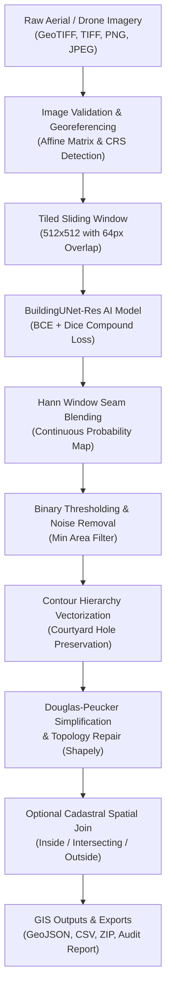

# UrbanFootprint AI
### AI-Powered Building Footprint Extraction & Geospatial Mapping
**Smart India Hackathon (SIH) 2026 — Problem P24**

[](https://haroonsarosh-lab.github.io/AI-Based-Urban-Building-Footprint-Extraction/)
[](https://www.python.org/)
[](https://fastapi.tiangolo.com/)
[](https://nextjs.org/)
[](https://pytorch.org/)
[](LICENSE)
[-brightgreen.svg)](docs/testing_report.md)

> 🚀 **Live Demo:** Explore the web application live on GitHub Pages:  
> **[https://haroonsarosh-lab.github.io/AI-Based-Urban-Building-Footprint-Extraction/](https://haroonsarosh-lab.github.io/AI-Based-Urban-Building-Footprint-Extraction/)**

---

## 1. Problem Statement

Manual digitizing of building footprints from high-resolution aerial, satellite, and drone imagery is labor-intensive, error-prone, and unsustainable for rapid urban expansion, municipal property indexing, and disaster response. 

**SIH 2026 Problem P24** requires an automated end-to-end system capable of:
1. Ingesting aerial, satellite, and UAV imagery with optional georeferencing information.
2. Generating high-fidelity binary building segmentation masks and continuous probability maps.
3. Extracting topologically valid, simplified polygon geometries with interior hole preservation (e.g. courtyards).
4. Preserving coordinate reference systems (CRS) and affine geotransforms.
5. Performing spatial joins against cadastral parcel boundaries to index building-to-parcel relationships.
6. Exporting GIS-ready formats (GeoJSON, CSV attributes, structured ZIP bundles, and downloadable audit reports).

---

## 2. Proposed Solution: UrbanFootprint AI

**UrbanFootprint AI** is a full-stack, enterprise-grade geospatial intelligence software application combining deep learning semantic segmentation with advanced GIS topological processing.

### Key Capabilities:
- **Res-UNet Segmentation Engine**: Deep learning architecture with residual convolutional blocks and skip connections optimized for sharp rooftop delineation.
- **Tiled Sliding-Window Inference**: Seamlessly processes gigapixel satellite rasters without out-of-memory crashes using 2D Hann window blending to eliminate tile boundary seams.
- **Topological Polygon Vectorization**: Extracts building exterior boundaries and courtyard holes using OpenCV two-level contour hierarchies (`cv2.RETR_CCOMP`), repairs self-intersections with Shapely, and simplifies boundaries via Douglas-Peucker.
- **Dual Coordinate Engine**: Preserves native EPSG projected/geographic coordinate systems for GeoTIFFs, with a dedicated Cartesian pixel-space viewer for non-georeferenced images (never misrepresenting pixel coordinates as latitude/longitude).
- **Cadastral Spatial Join**: Categorizes footprints as `inside`, `intersecting`, or `outside` parcel boundaries, computing built-up density and footprint coverage.
- **Zero-Fabrication Reporting**: Complete audit trails with honest operational metrics, model checkpoint validation, and downloadable JSON reports.

---

## 3. System Architecture & Data Flow



---

## 4. Technology Stack & Rationale

| Layer | Technologies | Rationale |
| :--- | :--- | :--- |
| **Frontend** | Next.js 16 (App Router), React 19, TypeScript, Tailwind CSS | High-performance, modern geospatial intelligence interface with zero-dependency native SVG icons and interactive HTML5 Canvas. |
| **Backend** | Python 3.11+, FastAPI, Uvicorn, Pydantic v2 | High-throughput asynchronous REST API with non-blocking background workers and automatic OpenAPI Swagger documentation. |
| **AI / ML** | PyTorch, NumPy, Pillow, OpenCV | Custom `BuildingUNet-Res` model with residual skips, compound BCE+Dice loss, and sliding-window seam blending. |
| **GIS & Math** | Shapely, PyProj, Tifffile | Rigorous topology validation (`make_valid`), coordinate transformation, and GeoTIFF tag extraction. |
| **Database** | SQLite3 | Zero-configuration, serverless ACID persistence for jobs, statistics, and audit reports. |

---

## 5. Distinct Concepts: Segmentation vs. Polygons vs. Cadastral Parcels

> [!IMPORTANT]
> **Understanding the Geospatial Hierarchy:**
> 1. **Semantic Segmentation**: Generates a per-pixel raster classification (probability map / binary mask) indicating the likelihood that a pixel represents a rooftop.
> 2. **Polygon Extraction**: Vectorizes raster boundaries into structured geometric polygons $(X, Y)$ with simplified edges, calculating area and perimeter.
> 3. **Cadastral Parcel Mapping**: Represents legally registered revenue land boundaries.
>
> **Legal Disclaimer:** Automated building footprint extraction and spatial joins provide planning and analytical assistance. They **do NOT establish legal property ownership, cadastral boundaries, or land-title rights**.

---

## 6. Installation & Execution (Windows 11)

### Quick Start (One-Click)
Run the automated Windows batch scripts:
```cmd
REM 1. Automated environment setup & dependency installation
setup.bat

REM 2. Launch both FastAPI backend and Next.js frontend
run.bat
```

---

### Manual Setup Instructions

#### Step 1: Backend Setup
```powershell
# Create and activate virtual environment
python -m venv .venv
.venv\Scripts\activate

# Install dependencies
pip install --upgrade pip
pip install -r backend/requirements.txt --extra-index-url https://download.pytorch.org/whl/cpu

# Run automated test suite
python -m pytest backend/tests -v

# Start FastAPI backend server
python -m uvicorn backend.app.main:app --host 127.0.0.1 --port 8000 --reload
```
*Backend API and Swagger UI will be live at `http://127.0.0.1:8000/api/docs`.*

#### Step 2: Frontend Setup
```powershell
cd frontend
npm install
npm run dev
```
*Frontend GIS Dashboard will be live at `http://localhost:3000`.*

---

## 7. Model Training & Evaluation

UrbanFootprint AI supports both real benchmark datasets (SpaceNet, Inria) and an integrated synthetic verification dataset.

### A. Training on Synthetic Verification Data
```powershell
.venv\Scripts\python.exe -m ml.train --synthetic --epochs 5 --batch-size 2
```

### B. Training on SpaceNet or Inria Real Imagery
```powershell
.venv\Scripts\python.exe -m ml.train --data-dir ./data/datasets/inria --epochs 30 --batch-size 8 --lr 0.0005
```

### C. Benchmark Metrics
- **Intersection over Union (IoU / Jaccard Index)**: $\frac{\text{TP}}{\text{TP} + \text{FP} + \text{FN}}$
- **Dice Coefficient (F1-Score)**: $\frac{2 \cdot \text{TP}}{2 \cdot \text{TP} + \text{FP} + \text{FN}}$
- **Precision**: $\frac{\text{TP}}{\text{TP} + \text{FP}}$
- **Recall**: $\frac{\text{TP}}{\text{TP} + \text{FN}}$

---

## 8. SIH 2026 Judge Demonstration Script (3-Minute Pitch)

1. **The Hook (30s)**: Introduce the challenge of manual building digitization in urban local bodies (ULBs) and present UrbanFootprint AI. Show the live **Dashboard** displaying real-time operational statistics and model readiness.
2. **The Extraction (60s)**:
   - Navigate to **New Extraction**.
   - Click **"Load Sample Aerial Patch (512x512)"** (or drag and drop a GeoTIFF).
   - Point out the configurable sliders (confidence threshold, patch tiling, Douglas-Peucker simplification).
   - Click **"Start Extraction Job"**.
3. **The GIS Workspace (60s)**:
   - Show the real-time background processing transition.
   - Demonstrate the interactive canvas: toggle layers (Satellite Image, Translucent Teal Mask, Vector Polygons).
   - Pan and zoom across the imagery.
   - Click on an individual building in the **Building Attributes Table** (e.g. `BLD-0002`) to show bidirectional canvas highlighting.
   - Show the detected area ($m^2$/pixels) and confidence score.
4. **The Deliverables & Compliance (30s)**:
   - Click **"GeoJSON"** and **"Download GIS Package (.zip)"** to show GIS-ready exports.
   - Highlight the **Spatial Data Leakage Prevention** methodology and the Cadastral Regulatory Notice.

---

## 9. Project Structure

```
urbanfootprint-ai/
├── backend/
│   ├── app/
│   │   ├── api/endpoints.py       # REST API endpoints
│   │   ├── core/config.py         # Application settings
│   │   ├── db/database.py         # SQLite persistence
│   │   ├── geospatial/            # Geospatial processing engine
│   │   │   ├── georef.py          # GeoTIFF CRS & affine transform parser
│   │   │   ├── polygonizer.py     # Contour vectorization & simplification
│   │   │   ├── parcels.py         # Cadastral spatial join engine
│   │   │   └── exporter.py        # GeoJSON, CSV & ZIP exporter
│   │   ├── schemas/jobs.py        # Pydantic models
│   │   ├── services/job_service.py# Async background worker
│   │   └── main.py                # FastAPI entry point
│   ├── tests/                     # 13 automated unit & integration tests
│   └── requirements.txt           # Backend dependencies
├── ml/
│   ├── model.py                   # BuildingUNet-Res architecture
│   ├── inference.py               # Tiled inference & Hann seam blending
│   ├── dataset.py                 # Dataset loaders & synthetic generator
│   ├── train.py                   # BCE+Dice training loop
│   └── evaluate.py                # IoU, Dice, Precision, Recall metrics
├── frontend/
│   ├── src/
│   │   ├── app/                   # Next.js App Router (page.tsx, layout.tsx)
│   │   ├── components/            # UI Views (Dashboard, Workspace, etc.)
│   │   └── lib/api.ts             # API client
│   └── package.json
├── data/                          # Uploads, processed rasters, checkpoints
├── outputs/                       # Downloadable GIS packages
├── docs/                          # Comprehensive technical documentation
├── setup.bat                      # Windows setup script
├── run.bat                        # Windows execution launcher
└── README.md
```

---

## 10. License & Attribution

- **License**: MIT License.
- **SpaceNet Data**: CC BY-SA 4.0 (SpaceNet on AWS Open Data).
- **Inria Aerial Data**: Open Government Licence (Inria Sophia Antipolis).
