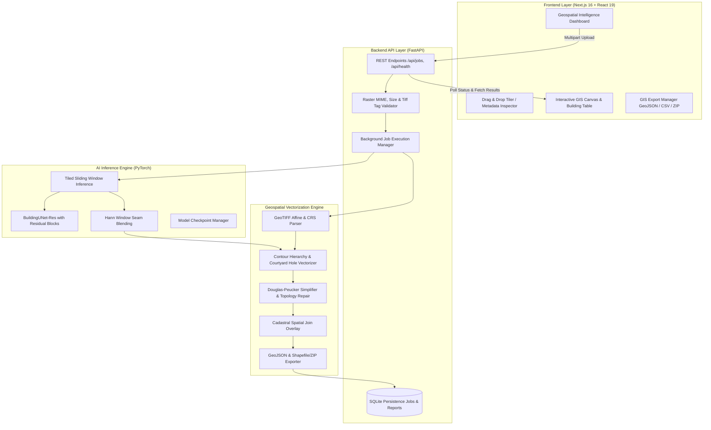

# System Architecture — UrbanFootprint AI

**UrbanFootprint AI** is an enterprise-grade geospatial computer vision platform engineered for SIH 2026 Problem P24: **AI-Based Urban Building Footprint Extraction**.

---

## 1. High-Level Architecture Overview

---

## 2. Component Breakdown

### A. Frontend Layer (Next.js & TypeScript)
- **Framework**: Next.js 16 (App Router) with React 19.
- **Styling**: Tailwind CSS tailored to the palette of professional defense & geospatial intelligence dashboards (`#f8fafc` slate neutral background, `#0f172a` deep navy typography, `#0284c7` ocean blue primary, `#0d9488` teal accents).
- **Interactive Map & Canvas**: HTML5 Canvas rendering engine with zoom, pan, layer toggling (Satellite Image, AI Mask, Probability Heatmap, Building Polygons, Cadastral Parcels), opacity controls, and bidirectional row-highlighting.
- **State Management**: Real-time polling with automated reconnection, error reporting, and export management.

### B. Backend Services (FastAPI & Uvicorn)
- **Async Execution**: Upload requests immediately respond with `202 Accepted` and a unique persistent Job ID (`uf-xxxxxxxxxx`), delegating tiled segmentation and polygonization to background worker threads.
- **Persistence**: SQLite database storing operational statistics, processing times, bounding boxes, warnings, and result paths.
- **Input Validation**: Rejects corrupted files, unsupported formats, and enforces size limits.

### C. AI Inference Pipeline (PyTorch)
- **Architecture**: `BuildingUNet-Res` — a lightweight U-Net architecture with residual convolutional blocks, batch normalization, dropout, and bilateral skip connections.
- **Tiled Sliding Window**: Processes arbitrary-size rasters without out-of-memory errors by slicing inputs into overlapping patches (default 512×512 with 64px overlap).
- **Hann Window Boundary Blending**: Multiplies overlapping tile probability matrices by a 2D Hann window before accumulation to eliminate tile boundary seams.

### D. Geospatial Processing & Vectorization
- **Coordinate Systems**: Preserves native EPSG codes and affine transforms for GeoTIFFs. Converts pixel polygons to WGS84 (`EPSG:4326`) while calculating physical square-meter areas in projected metric systems.
- **Contour Hierarchy**: Uses `cv2.findContours` with two-level hierarchy (`cv2.RETR_CCOMP`) to detect interior building courtyards as holes inside outer building boundaries.
- **Geometric Repair**: Automatically repairs self-intersections and slivers using Shapely topology validation.
- **Cadastral Spatial Join**: Performs overlay analysis testing whether building polygons are `inside`, `intersecting`, or `outside` user-provided cadastral parcels.
